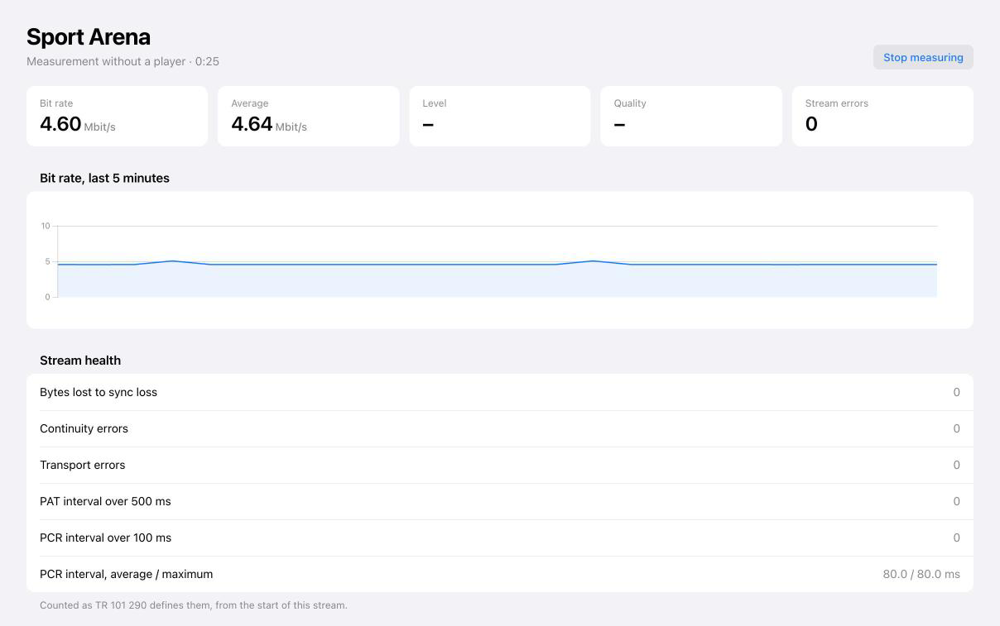

# Nightwave

Your own television server. Nightwave collects channels from your tuners and web playlists, lets you sort them into bouquets, and serves each bouquet as an M3U playlist with an XMLTV guide. Every player that understands those formats works with it, and Plex, Emby and Jellyfin can use it as a HDHomeRun.

Streams go out exactly as the source delivers them, with no transcoding.



## Features

- **Tuners:** SAT>IP servers, cable FRITZ!Box routers, DVB-S/C/T cards on Linux, HDHomeRun devices and M3U playlists.
- **Efficient with tuners:** several clients, and several channels on one transponder, share one tuner.
- **Bouquets:** build channel lists across all tuners, each with its own playlist, guide and access token.
- **Guide:** taken from the broadcast or from an XMLTV source.
- **Media servers:** one bouquet can appear as a HDHomeRun device.
- **Stable pictures:** stream repair bridges short dropouts, and a lost tuner is tuned again by itself.
- **Live monitor:** bit rate, signal and stream errors for every running stream, no player needed.
- **Channel logos:** picons for satellite channels, or your own per channel.
- **Web tuners:** an optional HTTP or SOCKS proxy per tuner.
- **Web interface:** in English and German, with light and dark mode.

## Getting started

Install Nightwave in one of these ways.

**Docker**

```sh
docker run -d --name nightwave --network host -v ./data:/data ghcr.io/pjacobs-eu/nightwave:latest
```

**Debian and Ubuntu**

```sh
sudo install -d /etc/apt/keyrings
curl -fsSL https://pjacobs.eu/nightwave/nightwave.gpg | sudo tee /etc/apt/keyrings/nightwave.gpg > /dev/null
echo "deb [signed-by=/etc/apt/keyrings/nightwave.gpg] https://pjacobs.eu/nightwave stable main" | sudo tee /etc/apt/sources.list.d/nightwave.list
sudo apt update
sudo apt install nightwave
```

**Windows, macOS and Linux**

Download the archive for your system from the [releases page](https://github.com/pjacobs-eu/nightwave/releases), unpack it and start `nightwaved`. No .NET is needed. The programs are not signed, so Windows and macOS show a warning. On macOS, run `xattr -dr com.apple.quarantine .` in the unpacked directory first.

Then set it up:

1. Open `http://<host>:9985` and choose a password.
2. Add a tuner under **Tuners**. SAT>IP servers on your network are found by themselves.
3. Run a scan under **Channel scan**. Web playlists load their channels without one.
4. Create a bouquet under **Bouquets** and add channels.
5. Copy the bouquet's playlist and guide addresses into your player.

## Good to know

- Nightwave is young. DVB cards in particular have not been tested on real hardware yet.
- Docker needs host networking, because SAT>IP uses multicast and RTP. For a DVB card, also pass `--device /dev/dvb`.
- When all tuners are busy, a client with one running stream can change channel, and the new channel takes over its tuner. Clients are told apart by IP address, so two devices behind one address count as one.

## Build from source

You need the [.NET 10 SDK](https://dotnet.microsoft.com/download/dotnet/10.0).

```sh
dotnet run --project src/Nightwave.Server -c Release
```

## License

[MIT](LICENSE). Third-party components are listed in [NOTICE](NOTICE). The channel logos are a separate data file under GPL-3.0.
